# 人形机器人使用说明书

## 第一章 产品概述

### 1.1 产品简介与型号说明

`Z01` 是本产品的对外产品型号，`T4` 是内部研发型号。本产品为一款面向科研院校的双足人形机器人，定位为教学与科研兼顾型平台，适用于运动控制研究、具身智能算法验证、视觉导航、操作实验及教学演示等应用场景。

本产品主要面向高校实验室、科研院所、职业教育及教学实训机构，可为机器人控制、感知、导航、人机交互及综合实验教学提供平台支撑。产品以室内应用为主，在满足场地平整、安全可控等条件下，可在有限室外平整地面环境中使用。

本产品采用整机交付方式，用户开箱后按要求完成基础检查与初始化配置即可投入使用，无需进行复杂装配。产品支持二次开发，但二次开发能力在本说明书中作为辅助特点说明，用户应以标准操作、安全使用和基础维护要求为优先。

### 1.2 主要技术参数

| 参数项目 | 参数说明 |
| --- | --- |
| 产品型号 | Z01 |
| 内部研发型号 | T4 |
| 机器人类型 | 双足人形机器人 |
| 产品定位 | 教学与科研兼顾型平台 |
| 适用对象 | 科研院校 |
| 身高 | 1.3 m |
| 体重 | 37 kg |
| 全身自由度 | 31 自由度 |
| 自由度分配 | 头部 2，自由臂左/右各 7，腰部 3，左/右腿各 6 |
| 静态续航时间 | 约 4 小时 |
| 常规行走续航时间 | 约 2 小时 |
| 主控平台 | CPU + GPU（可选） |
| 内存 | 32GB |
| 存储 | 256GB |
| 电池类型 | 可充电锂离子电池 |
| 电池额定电压 | 46.8 V |
| 电池额定容量 | 449.28 Wh |
| 电池更换方式 | 支持热拔插 |
| 通信方式 | 有线以太网、Wi-Fi、4G/5G |
| 蓝牙 | 不支持 |
| 主要传感器/交互硬件 | 深度相机、激光雷达、IMU、麦克风阵列、扬声器 |
| 末端执行器 | 预留安装位，默认不含夹爪等末端执行器 |
| 最高行走速度 | 2 m/s（保守标称值） |
| 最大爬坡能力 | XX |
| 上下楼梯能力 | XX |
| 防护等级 | XX |
| 工作温度范围 | XX |
| 存储温度范围 | XX |

说明：

1. 本章节中的 `XX` 为待补充参数，后续可根据正式配置版本统一修订。
2. 续航时间与行走速度受地面条件、动作模式、负载状态、电池健康度及环境温度等因素影响。

### 1.3 外观结构与部件识别

本产品主要由头部、躯干、上肢、下肢、背部底下接口区和电池仓等部分组成。

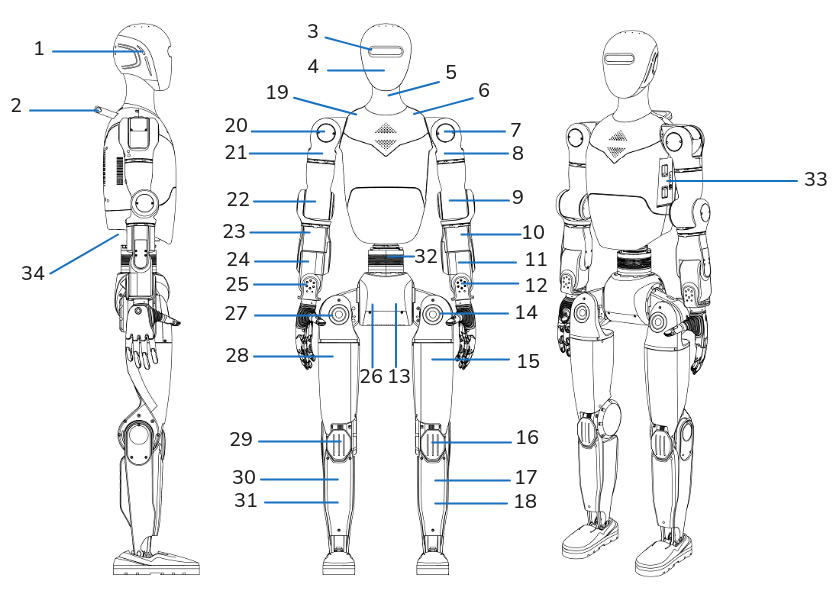

图中数字标识可按下表进行说明：

| 序号 | 部位名称 | 说明 |
| --- | --- | --- |
| 1 | 头部灯带 | 用于设备状态显示与交互提示 |
| 2 | 后背把手 | 用于机器人保护、转运和受控状态下的手持辅助 |
| 3 | 头部深度相机 | 用于环境感知、视觉识别与相关实验功能 |
| 4 | 头部旋转关节 | 用于控制头部左右转动，支撑视线方向调整与头部姿态控制 |
| 5 | 头部俯仰关节 | 用于控制头部前俯和后仰，支撑头部俯仰姿态调整 |
| 6 | 左肩俯仰关节 | 用于控制左臂前后摆动，是左上肢主要抬举关节之一 |
| 7 | 左肩横滚关节 | 用于控制左臂向身体侧向展开或收回 |
| 8 | 左肩偏航关节 | 用于控制左上臂绕轴旋转，配合完成复合手臂动作 |
| 9 | 左肘屈伸关节 | 用于控制左前臂弯曲和伸直 |
| 10 | 左腕偏航关节 | 用于控制左腕左右旋转，配合末端方向调整 |
| 11 | 左腕俯仰关节 | 用于控制左腕上抬和下压动作 |
| 12 | 左腕横滚关节 | 用于控制左腕横向翻转，提升末端姿态灵活性 |
| 13 | 左髋俯仰关节 | 用于控制左腿前摆和后摆，是步行动作的关键关节之一 |
| 14 | 左髋横滚关节 | 用于控制左腿侧向展开和重心横向调节 |
| 15 | 左髋偏航关节 | 用于控制左腿绕髋部旋转，配合转向和姿态调整 |
| 16 | 左膝屈伸关节 | 用于控制左膝弯曲和伸直，支撑站立、下蹲和行走动作 |
| 17 | 左踝俯仰关节 | 用于控制左脚前后倾角，配合步态落脚与重心控制 |
| 18 | 左踝横滚关节 | 用于控制左脚左右侧倾，配合平衡与地面适应 |
| 19 | 右肩俯仰关节 | 用于控制右臂前后摆动，是右上肢主要抬举关节之一 |
| 20 | 右肩横滚关节 | 用于控制右臂向身体侧向展开或收回 |
| 21 | 右肩偏航关节 | 用于控制右上臂绕轴旋转，配合完成复合手臂动作 |
| 22 | 右肘屈伸关节 | 用于控制右前臂弯曲和伸直 |
| 23 | 右腕偏航关节 | 用于控制右腕左右旋转，配合末端方向调整 |
| 24 | 右腕俯仰关节 | 用于控制右腕上抬和下压动作 |
| 25 | 右腕横滚关节 | 用于控制右腕横向翻转，提升末端姿态灵活性 |
| 26 | 右髋俯仰关节 | 用于控制右腿前摆和后摆，是步行动作的关键关节之一 |
| 27 | 右髋横滚关节 | 用于控制右腿侧向展开和重心横向调节 |
| 28 | 右髋偏航关节 | 用于控制右腿绕髋部旋转，配合转向和姿态调整 |
| 29 | 右膝屈伸关节 | 用于控制右膝弯曲和伸直，支撑站立、下蹲和行走动作 |
| 30 | 右踝俯仰关节 | 用于控制右脚前后倾角，配合步态落脚与重心控制 |
| 31 | 右踝横滚关节 | 用于控制右脚左右侧倾，配合平衡与地面适应 |
| 32 | 腰部偏航关节 | 位于躯干与下肢之间，用于控制腰部左右旋转，配合转向、平衡与上身姿态调整 |
| 33 | 电池仓 | 用于电池安装、更换及侧面接口操作 |
| 34 | 背部底下接口区 | 用于有线通信、调试连接及外部设备接入 |

#### 1.3.1 头部

头部集成以下主要可识别部件：

- 深度相机
- 麦克风阵列
- 扬声器
- 灯带

上述部件主要用于环境感知、语音交互、状态提示等功能。

#### 1.3.2 上肢

左右上肢结构对称，每侧 7 自由度。主要关节组成如下：

- 肩关节：俯仰、横滚、偏航
- 肘关节：屈伸
- 腕关节：偏航、俯仰、横滚
- 末端：预留安装位

上肢主要用于动作演示、操作实验及扩展末端执行器安装。

#### 1.3.3 下肢

左右下肢结构对称，每侧 6 自由度。主要关节组成如下：

- 髋关节：俯仰、横滚、偏航
- 膝关节：屈伸
- 踝关节：俯仰、横滚

下肢系统主要用于站立、行走、转向、姿态调整与平衡控制。

#### 1.3.4 躯干与电池仓

机身背部设置有把手，可用于受控状态下的人工作业辅助稳控、搬扶或配合阻尼状态操作。背部把手不应替代正式搬运工具或安全防护措施使用。

机身肩部设计有专用挂钩，便于机器人悬空吊运与转移。

机身设置有电池仓，用于安装和更换动力电池。电池本体带有电源开关和电量/状态指示灯，用户可据此完成上电前检查与电量确认。

#### 1.3.5 背部底下接口区

机身背部底下设置接口区，当前已确认包含以下接口：

- 1个USB接口和1个Type-C接口
- 2个有线网口

该区域主要用于有线通信、调试连接及外部设备接入。

#### 1.3.6 急停装置说明

本产品急停装置为外接手持式无线急停器，不集成于机器人本体。用户在操作、调试、测试及演示过程中，应确保无线急停器处于随手可及、通信正常的状态，以便在异常情况下立即执行急停。

### 1.4 适用场景与限制说明

#### 1.4.1 适用场景

本产品适用于科研院校的实验室算法验证、课堂教学演示、室内导航研究、人机交互研究及操作实验等场景。

#### 1.4.2 限制说明

为确保人员与设备安全，本产品不适用于以下场景或使用方式：

- 湿滑、松软、严重不平整或存在明显空洞的地面环境
- 人员密集且未设置安全隔离的环境中的高速运动、快速转向或自主导航测试
- 强雨、积水、冰雪、大风、强电磁干扰等不利环境条件
- 载人、牵引人员或承载超出设计范围的外部负载
- 易燃易爆、有毒有害、强腐蚀性物质接触或其他高危险作业场景
- 未完成校准、自检异常、通信不稳定或操作人员无法随时接管时执行复杂动作或自主任务

用户应根据具体实验任务、场地条件和安全管理制度，对设备使用范围进行二次确认。

### 1.5 包装清单与配件说明

本产品标准交付内容可按合同或订单配置执行。当前版本可确认的包装清单如下：

| 序号 | 名称 | 数量 | 说明 |
| --- | --- | --- | --- |
| 1 | 机器人本体 | 1 台 | Z01 双足人形机器人整机 |
| 2 | 电池 | 按合同/订单配置 | 可充电锂离子电池 |
| 3 | 充电器 | 1 套 | 用于电池充电 |
| 4 | 无线急停器 | 1 套 | 外接手持式无线急停装置 |
| 5 | 遥控器 | 1 套 | 用于基础操作与控制 |
| 6 | 包装箱体 | 1 套 | 用于运输和存放 |
| 7 | 使用说明书 | 1 份 | 本文档 |

说明：

1. 实际交付内容以合同、订单、装箱单及产品配置清单为准。
2. 如产品存在选配件、扩展模块或定制部件，应在正式交付文件中单独列明。

## 第二章 安全须知

本产品属于具备自主或半自主运动能力的双足人形机器人设备。在安装、调试、操作、维护及演示过程中，若使用不当，可能造成人员伤害、设备跌倒、部件损坏或实验环境风险。所有操作人员应在充分理解本说明书内容后再进行相关作业。

### 2.1 安全警示标识说明

本说明书采用以下安全警示等级：

- 危险（Danger）：若不避免，将导致严重人身伤害或重大设备损坏。
- 警告（Warning）：若不避免，可能导致人身伤害或设备损坏。
- 注意（Caution）：若不避免，可能导致轻微伤害、误操作或性能异常。
- 提示（Notice）：用于补充操作要求、限制条件或建议事项。

在阅读和执行本说明书中的操作步骤时，用户应结合上述警示等级理解对应风险，并采取匹配的防护措施。

### 2.2 操作前安全检查清单

每次上电、测试、演示或运行前，应至少完成以下安全检查：

- 检查电池电量是否充足，电池安装是否牢固，电池开关及状态指示是否正常。
- 检查无线急停器是否处于可用状态，并确认操作人员可随时触发急停。
- 检查场地地面是否平整、干燥、无明显打滑风险或结构缺陷。
- 检查机器人周边是否存在障碍物、悬空物、线缆、台阶边缘或无关人员。
- 检查机体外观是否存在破损、松动、变形或异常碰撞痕迹。
- 检查各关节活动区域是否存在异物卡阻风险。
- 检查深度相机、激光雷达等传感器表面是否清洁，无遮挡、污渍或损伤。
- 检查网络连接、遥控连接及必要的人机交互链路是否正常。
- 检查系统自检结果是否正常，若存在异常提示，不得直接投入运行。

如任一检查项目未通过，应停止本次运行，待风险消除后再继续使用。

### 2.3 人员安全距离与防护要求

在机器人调试、测试、演示和运行过程中，应设置必要的安全隔离区域，非操作人员不得进入机器人运行范围。操作人员应始终位于可观察、可接管、可即时触发无线急停的位置。

个人防护方面，建议执行以下要求：

- 操作人员应穿着防滑鞋。
- 长发应束起，避免卷入运动部件或影响视线。
- 不应穿着过于宽松的衣物、围巾或其他可能卷入设备的物品。
- 在调试、首轮测试或风险较高的实验过程中，建议根据实际情况佩戴必要的防护用品。
- 未经培训或未获得授权的人员不得独立操作本产品。

提示：

1. 当机器人执行快速动作、转向测试、自主导航或实验性算法验证时，应适当提高现场防护等级。
2. 在存在摔倒风险的测试场景中，应提前明确操作分工、接管方式与急停责任人。

### 2.4 环境安全要求

为保证机器人稳定运行与人员安全，使用环境应满足以下基本要求：

- 地面应平整、坚实、干燥，避免湿滑、松软、碎石、线缆缠绕或明显起伏地面。
- 在未明确验证前，不应在超出允许坡度范围的斜面、楼梯边缘或复杂高低差区域运行。
- 机器人运行路径内不应存在明显障碍物、尖锐物、低矮绊倒物或突发移动目标。
- 室外使用应限于受控条件下的平整地面，不应在强雨、积水、冰雪、大风等天气环境中使用。
- 环境照明应满足相机、视觉识别及安全观察需求，避免强逆光、频闪、极暗环境或严重光照突变。
- 网络与通信环境应保持稳定，特别是在涉及远程监控、遥控接管、数据传输或协同控制时，不得在链路明显不稳定的情况下执行高风险动作。

注意：

1. 环境条件不达标时，可能导致感知误差、步态异常、定位失败、控制延迟或跌倒风险上升。
2. 当场地或环境状态发生变化时，应重新执行安全检查，而非沿用上一次测试条件。

### 2.5 紧急情况处置与急停操作

一旦出现失稳、误动作、通信失控、人员闯入危险区或环境异常，操作人员应立即按下无线急停器，并在机器人完全停止后再接近设备。

本产品使用外接手持式无线急停器作为紧急处置装置。无线急停主要用于紧急危险、失控或高风险异常场景，其动作逻辑为直接下电。触发急停后，机器人可能因失去动力支撑而直接摔倒。因此，无线急停应仅在必须立即切断动力、优先避免人员风险或扩大损失时使用。

急停后的标准处置流程如下：

1. 立即触发无线急停。
2. 确认机器人停止运动，并与设备保持安全距离。
3. 排查人员、场地、电源、通信和机械状态，确认是否存在二次风险。
4. 在未查明故障原因或风险未解除前，不得强行复位或继续运行。
5. 由具备权限的人员按照规范解除急停，并重新完成上电、自检及安全确认后再恢复使用。

危险（Danger）：

- 无线急停触发后机器人可能直接跌倒，周边人员不得在机器人倒向区域内停留。
- 不得将急停视作常规停机手段，不得在非紧急场景下频繁使用急停替代正常控制流程。

### 2.6 故障状态下的安全姿态

本产品在故障、异常处置或人工接管过程中，不保证自动进入安全站立姿态。不同处置方式对应的状态和风险不同，操作人员必须明确区分。

#### 2.6.1 无线急停后的状态

无线急停触发后，机器人直接下电，可能失去支撑并发生摔倒。该方式适用于失控、碰撞风险、人员危险或其他需要立即切断动力的场景，不适用于日常调姿、常规停机或普通实验切换。

#### 2.6.2 阻尼状态下的风险说明

本产品支持通过遥控器组合按键使机器人进入阻尼状态。进入阻尼状态后，机器人同样可能因失去主动支撑能力而发生摔倒。因此，阻尼状态仅适用于人为可控场景，例如：

- 机器人已处于吊钩保护状态。
- 操作人员已稳固握持机器人背部把手并具备可靠控制条件。

警告（Warning）：

- 在无人保护、无吊挂或无人工稳定控制的情况下，不得使机器人进入阻尼状态。
- 阻尼状态不能等同于安全姿态，其本质上仍属于需人工保护的过渡状态。

提示（Notice）：

- 进入阻尼或急停后，应优先评估机器人支撑状态、周边空间及人员站位，防止二次碰撞或夹伤。
- 若需在故障后重新扶正或搬扶机器人，应由经过培训的人员执行，并结合现场保护条件谨慎操作。

## 第三章 安装与初始化

本产品采用整机交付方式，用户无需进行复杂装配。首次使用前，应按照本章要求完成开箱检查、电池安装、充电、网络连接及基础初始化确认。

### 3.1 开箱检查

由于本产品为整机交付，用户开箱后的主要任务是完成设备检查与安全就位，而非复杂组装。

建议按以下流程操作：

1. 检查外包装箱体是否存在明显破损、受潮、倾倒或撞击痕迹。
2. 按照规范打开包装箱，核对随机附件与包装清单是否齐全。
3. 检查机器人本体外观是否存在结构损伤、部件松动、线缆脱落或运输异常痕迹。
4. 将机器人从包装中取出后，转移至平整、开阔、安全的测试区域。

机器人就位时，应由至少两人配合搬运或扶持，必要时结合吊装保护。不得单人强行搬运，不得通过拖拽下肢、抓提关节部位或其他不规范方式移动设备。

提示（Notice）：

- 开箱后如发现外观损坏、附件缺失或部件异常，应暂停使用并进行记录。
- 设备首次就位后，建议先完成静态检查，再进行电池安装与上电操作。

### 3.2 开箱步骤

打开包装箱，检查随机附件，包括机器人本体、遥控手柄、急停开关、锂电池和电池充电器各一个；

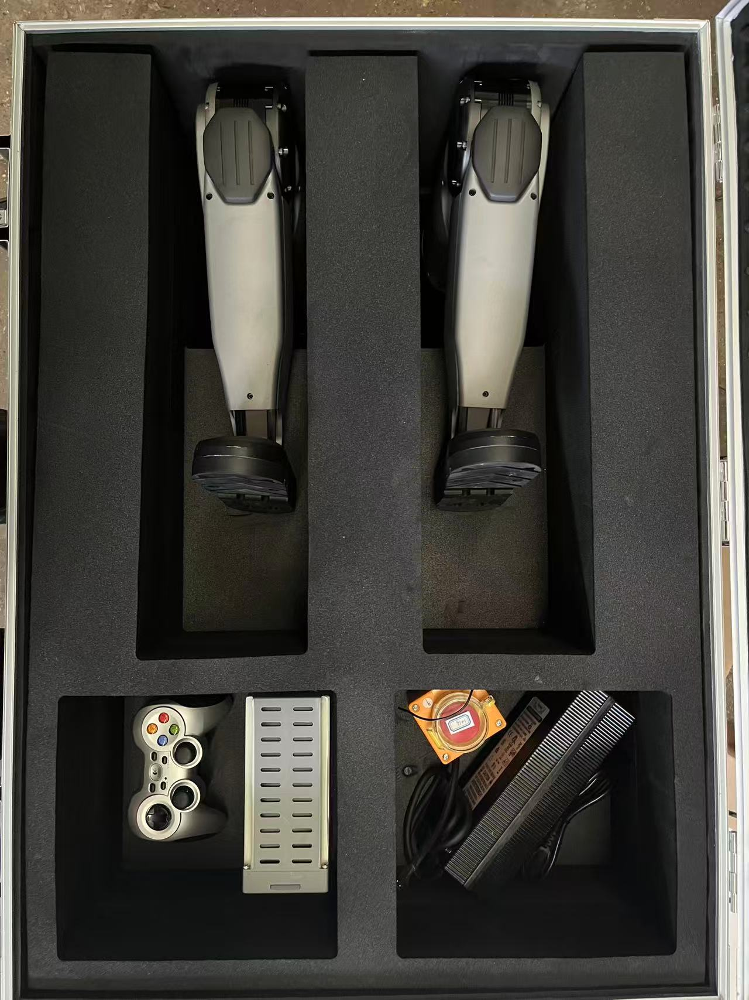

拿出泡棉，扶住双腿以免腿部弯曲砸坏机器人躯干的覆盖件；

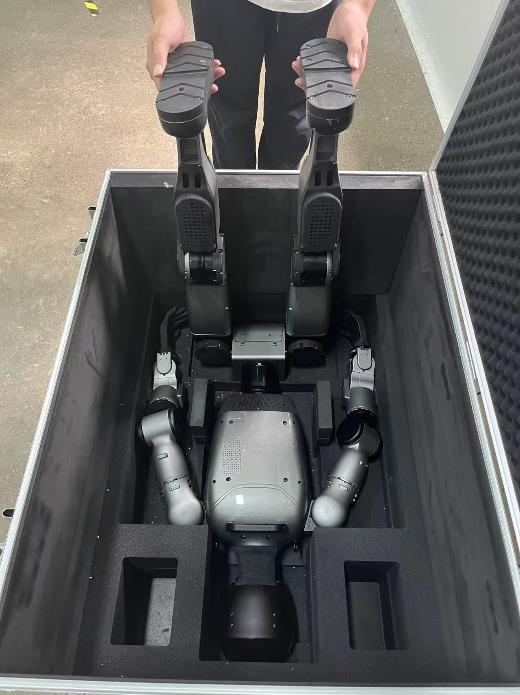

将吊机的挂钩勾住机器人肩部的扣环；

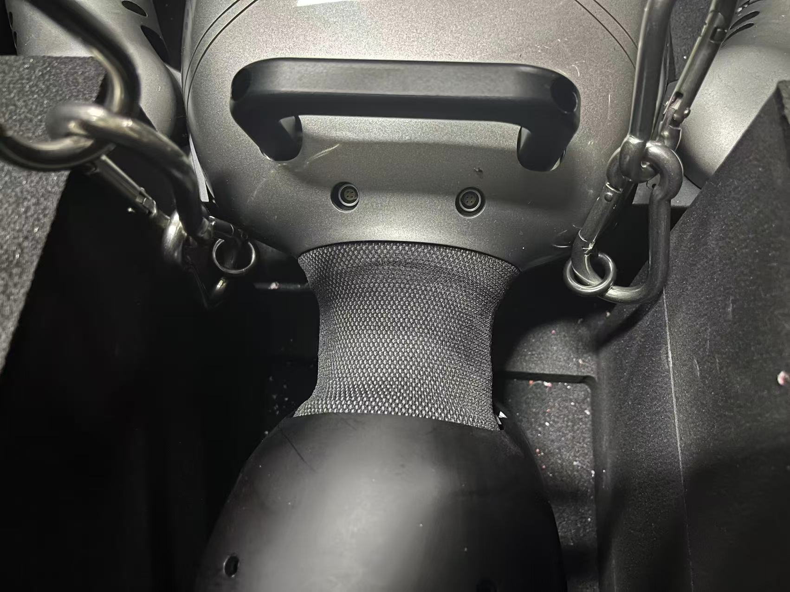

将吊机吊起，同时扶住机器人的双腿，使机器人高于箱体后，将包装箱移开；

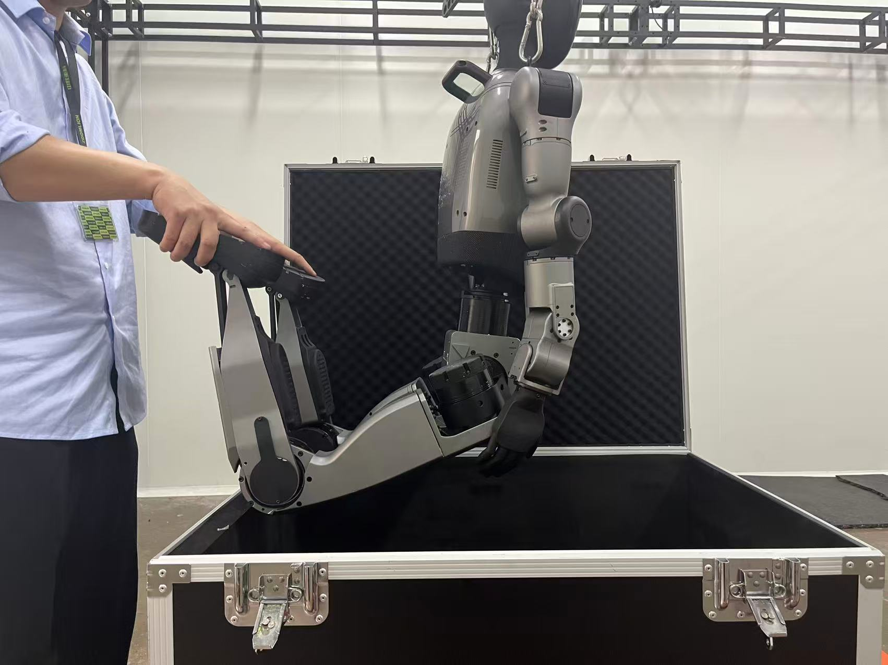

将机器人悬空吊起，保持各个关节位置处于垂直自然的零位附近；

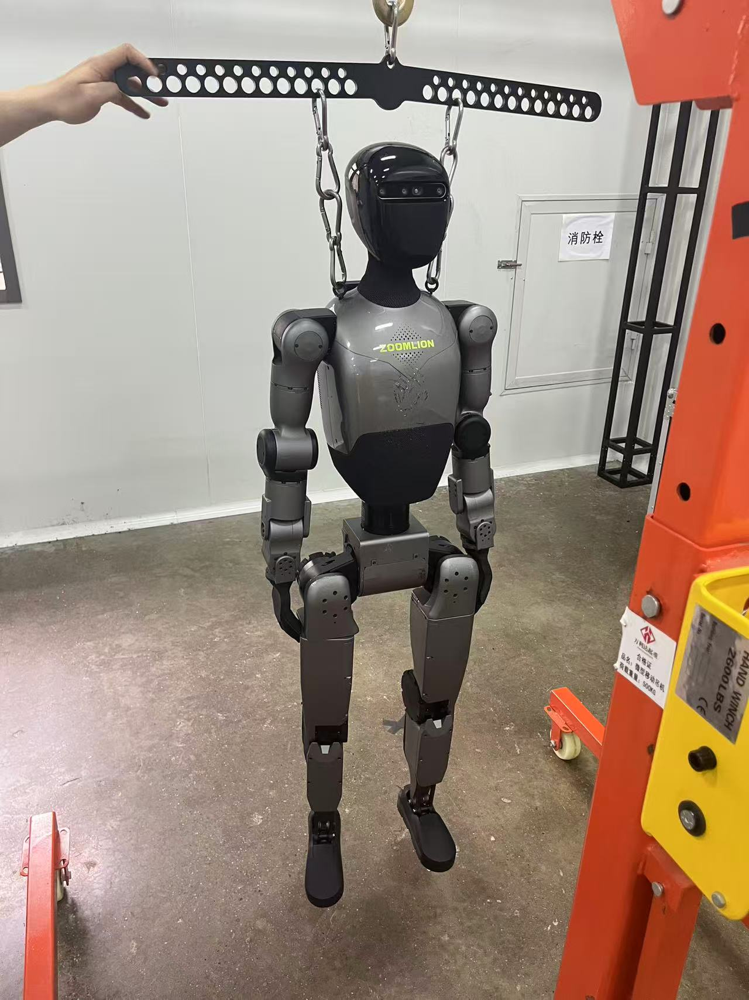

### 3.2 电池安装与充电规范

#### 3.2.1 电池安装

本产品使用可充电锂离子电池，额定电压为 46.8 V，额定容量为 449.28 Wh，支持热拔插。安装电池时，应确认电池方向正确。

电池安装要求如下：

1. 确认机器人处于安全静止状态。
2. 检查电池外观完好，无破损、鼓包、异味或异常发热现象。
3. 确保电池指示灯位于电池左侧的正确方向。
4. 从躯干左侧电池仓将电池平稳插入。
5. 电池插入后，应听到卡扣到位声。
6. 确认卡扣的上下拉扣位置均已顶到边缘，且电池与舱体结合处无明显缝隙。

若电池未安装到位，不得执行上电和运行操作。

短按电池开关，电池会指示灯会显示当前剩余电量；

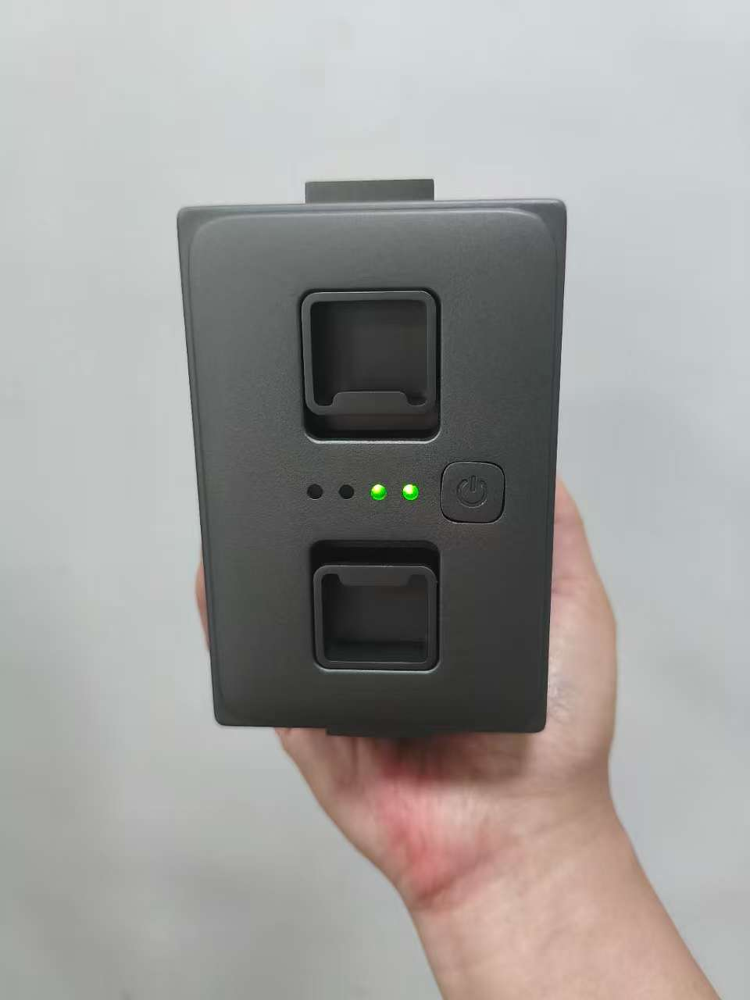

抬起机器人的左手，保持电池电源开关在电池的右侧，平稳的将电池插入电池仓；

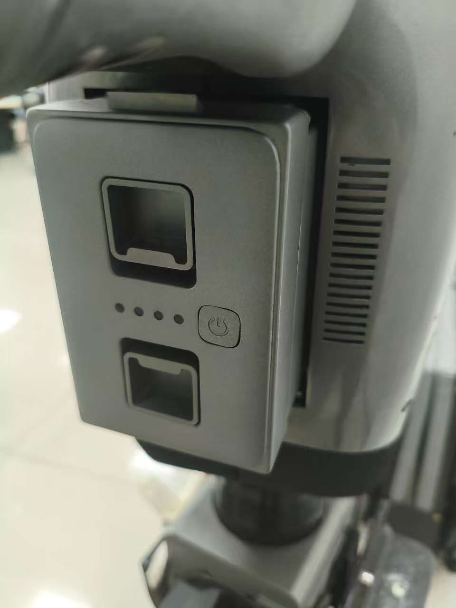

在电池插入后，会有卡扣卡住的声音，同时需要用手把卡扣上下两边卡紧，确保没有缝隙；

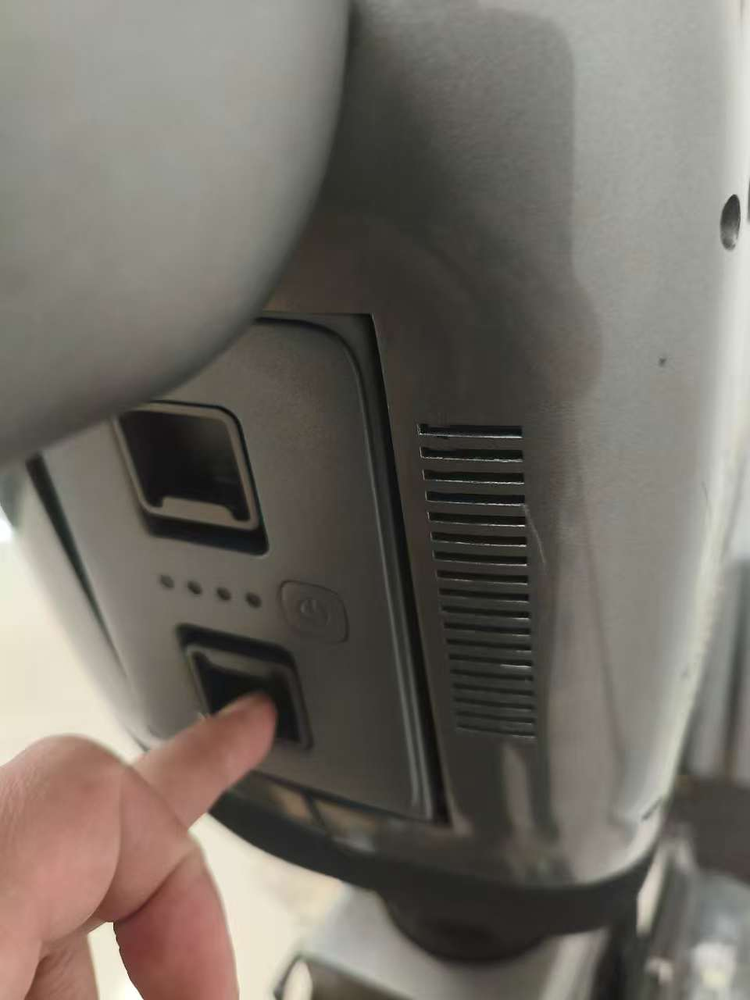

长按电源开关5秒以上，等待电池供电输出，此时机器人头部的灯带会点亮，躯干内风扇也会转到；

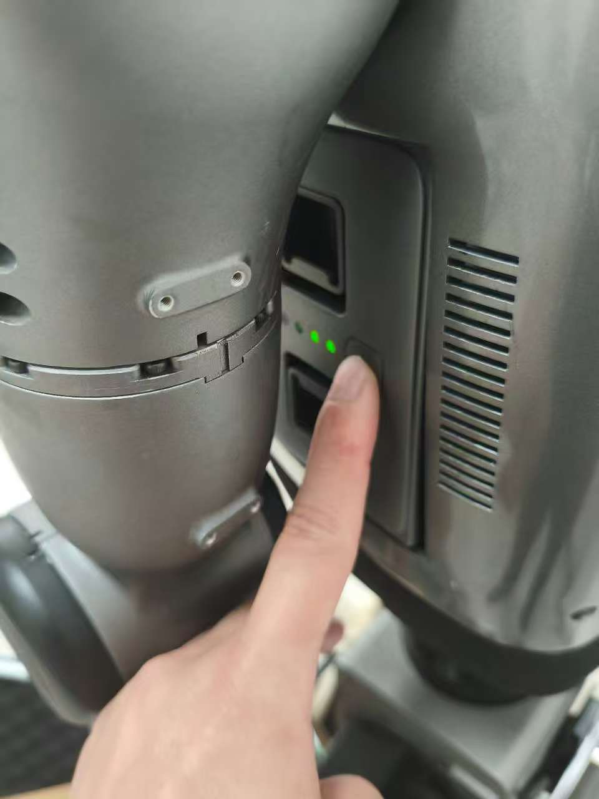

#### 3.2.2 电池上电与断电

长按电池开关可进行上电和断电操作。机器人整机通过电池开关启动，不设独立机身总电源按钮。

在断电或拆卸电池前，应确保机器人已处于安全静止状态，且周边具备足够安全空间。

#### 3.2.3 电池拆卸

拆卸电池时，应按以下顺序进行：

1. 长按电池开关，确认电池断电。
2. 拉开卡扣。
3. 平稳抽出电池。

拆卸过程中应避免冲击、跌落、卡滞或带载强行抽拔。

#### 3.2.4 充电规范

本产品电池应拆下后单独充电，不建议在机器人装载状态下进行充电。

充电时应按以下顺序操作：

1. 先连接电池。
2. 再连接市电。

充电状态可通过电池和充电器指示灯进行判断：

- 电池指示灯共 4 格，4 格全亮表示电池已充满。
- 充电器指示灯为红色时表示充电中。
- 充电器指示灯为绿色时表示已充满。

注意（Caution）：

- 充电应在通风良好、干燥、安全的环境中进行。
- 若发现充电异常、指示灯状态异常、电池明显发热或其他异常现象，应立即停止充电并检查原因。

### 3.3 网络配置

本产品当前版本无账户绑定要求，初始化过程主要涉及网络连接与远程登录配置。

#### 3.3.1 有线网络连接

机器人设有两个有线网口，默认使用靠近机器人中间的网口。默认 IP 地址为 `192.168.12.100`。

操作人员可通过有线网络将计算机与机器人连接，并进行调试、远程访问及网络配置操作。

#### 3.3.2 远程登录

计算机与机器人有线连接后，用户可通过 `NoMachine` 软件远程登录机器人系统。当前默认 Ubuntu 账户信息如下：

- 用户名：`zl`
- 密码：`admin`

首次接入后，建议由管理人员根据实际管理要求决定是否修改默认密码，非管理人员不得随意更改。

在用户计算机的Ubuntu系统中，按一下win按键，在弹出界面中的搜索框中，输入nomachine后显示程序图标，点击打开NoMachine程序；


打开NoMachine主界面；

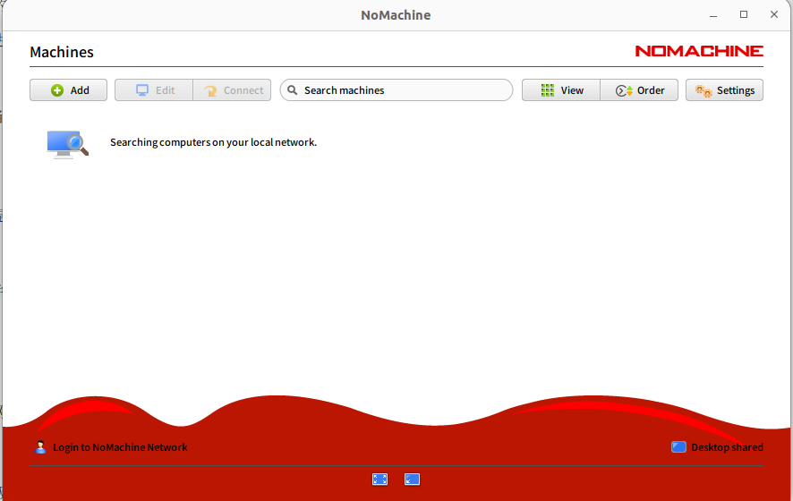

点击左上角的【Add】按钮，弹出选项框，选择【Add connection】菜单项；

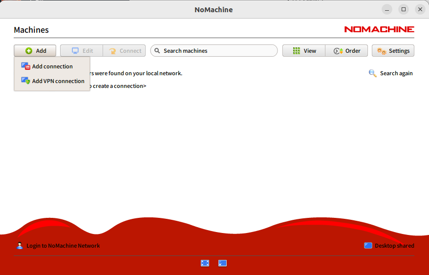

弹出新建连接配置窗口，在【Host】中输入192.168.12.100，点击右上角的【Add】按钮；

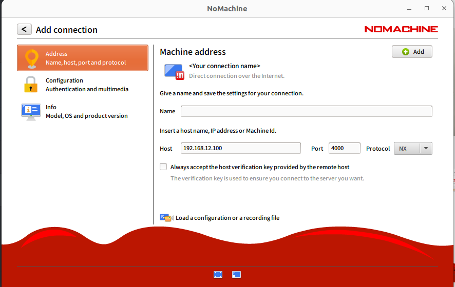

重新回到主界面，此项会新增一个连接对象，双击打开；

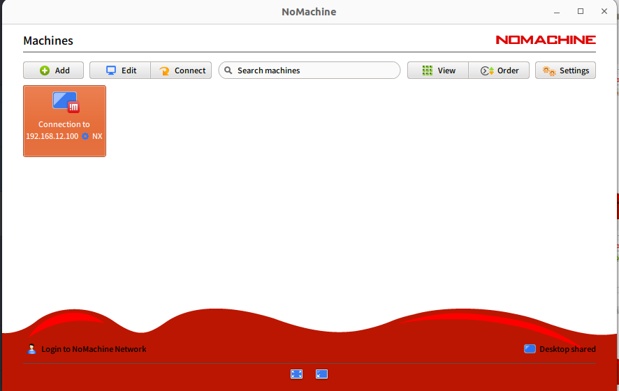

弹出新建连接窗口，【Username】中输入账号zl，【Password】中输入密码admin，勾选【Save this passwword in the connection file】，勾选【Always login using this method on this server】，点击【Ok】按钮；

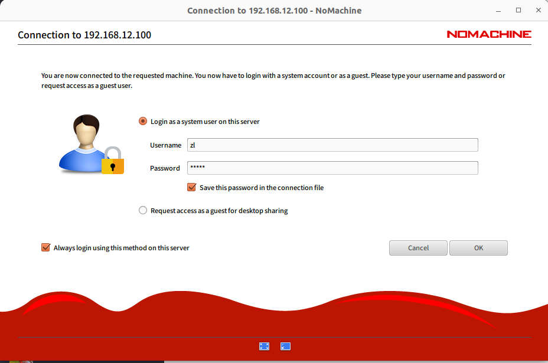

此时NoMachine即可进入到机器人自带的Ubuntu系统；

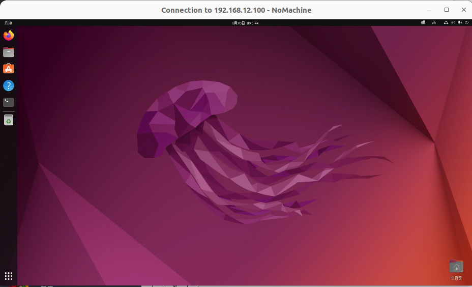

#### 3.3.3 无线网络配置

机器人具备 Wi-Fi 功能。操作人员可在完成有线连接并登录系统后，根据实际使用环境自行配置需要连接的无线网络。

提示（Notice）：

- 说明书中的网络参数应以正式交付版本为准。
- 本文档不包含开发阶段临时路由配置或内部测试网络参数。

进入机器人的Ubuntu系统后，点击右上角的网络连接，弹出网络设置菜单，点击wifi设置中的【选择网络】按钮；

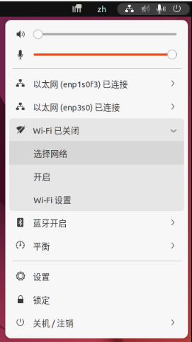

弹出WiFi网络设置界面，点击【开启Wi-Fi】按钮；

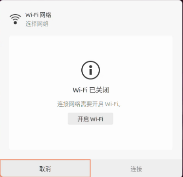

在WiFi网络设置界面中，会显示当前搜索到的无线网络，选择自己的WiFi网络，点击【连接】按钮；

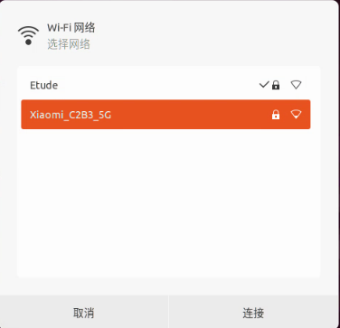

在认证界面输入WiFi网络的密码，点击【连接】按钮；

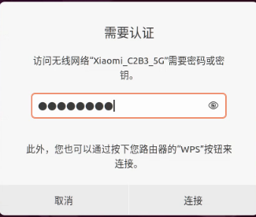

此时在网络设置菜单中可以看到已连接的WiFi网络；

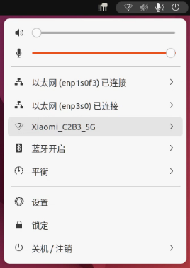

打开终端，也能够看到当前连接到WiFi网络后，分配的无线IP地址；

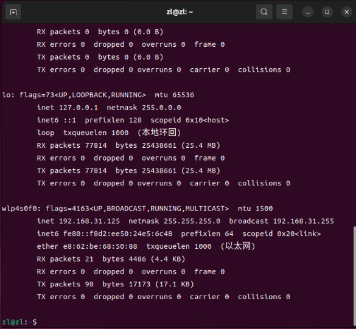

### 3.4 固件升级与校准

当前版本面向普通用户的使用说明中，不包含固件升级操作。用户不应自行执行固件升级。

机器人出厂前已完成零位标定与基础校准。若设备在长期使用后出现零位偏差问题，可由具备条件的人员配合专用标零工具进行重新标零。

提示（Notice）：

- 标零操作具有专业性和风险性，不属于普通用户日常初始化流程。
- 具体标零方法建议在后续单独技术章节或专门技术文档中说明。

## 第四章 基本操作指南

### 4.1 开机与关机

本产品当前无待机或唤醒机制，基本电源操作仅包括上电开机和断电关机。

#### 4.1.1 开机

机器人通过电池开关启动整机。每次开机都会自动执行关节自检。

开机流程如下：

1. 确认机器人已完成运行前条件检查，周边环境满足第二章安全要求。
2. 长按电池开关进行上电。
3. 观察机器人头部是否点亮。
4. 确认风扇启动，可通过声响判断系统已进入启动过程。
5. 等待机器人自动执行关节自检。
6. 根据系统提示判断自检结果。

正常情况下，系统会提示自检成功。若存在以下情况，则可能提示自检失败：

- 关节通信断开。
- 关节当前位置超出物理限位范围。

若系统提示自检失败，不得强行进入运行状态。此时应立即停止后续操作，检查关节通信、机器人姿态及周边安全条件；必要时执行断电，并由具备条件的人员进一步处理。


警告（Warning）：

- 自检失败状态下继续操作，可能引发姿态异常、误动作或跌倒风险。
- 对异常关节、通信故障或零位偏差未查明原因前，不得执行步行、起立或其他动态动作。

#### 4.1.2 关机

机器人通过长按电池开关执行断电关机。关机前应确保机器人已停止当前动作，并处于安全、可控状态。

注意（Caution）：

- 不得在机器人执行高风险动作、处于不稳定支撑状态或周边人员未撤离时直接断电关机。
- 紧急危险场景下应优先按照第二章要求使用无线急停器，而非将正常关机操作替代急停处置。


### 4.2 遥控器/手柄操作说明

本产品配套遥控器可用于执行模式切换、运行准备、模型进入、阻尼切换、待机模式及运动控制等操作。为避免误操作，涉及状态切换的关键功能均采用组合按键方式触发。

提示（Notice）：

- 遥控器不替代无线急停器。`LB + RB + Y` 的功能为进入阻尼模式，不等同于无线急停。
- 执行模式切换前，应确认机器人状态、场地安全条件和人员站位满足要求。

#### 4.2.1 遥控器正面按键标注说明

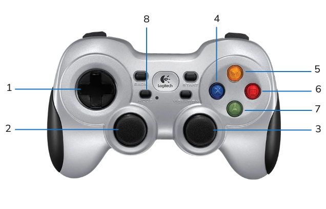

| 序号 | 按键名称 | 说明 |
| --- | --- | --- |
| 1 | 方向键 | 与LB / RB / LB + RB组合按键配合，用于执行不同动作 |
| 2 | 左摇杆 | 用于运动控制输入，具体映射见后续控制说明 |
| 3 | 右摇杆 | 用于运动控制输入，具体映射见后续控制说明 |
| 4 | X 按键（蓝色） | 与LB + RB组合按键配合，用于进入待机模式 |
| 5 | Y 按键（黄色） | 与LB + RB组合按键配合，用于进入阻尼模式 |
| 6 | B 按键（红色） | 与LB + RB组合按键配合，用于进入行走模型 |
| 7 | A 按键（绿色） | 与LB + RB组合按键配合，用于进入准备状态 |
| 8 | 模式按键 | 需确保模式指示灯处于熄灭 |

#### 4.2.2 遥控器侧面按键标注说明

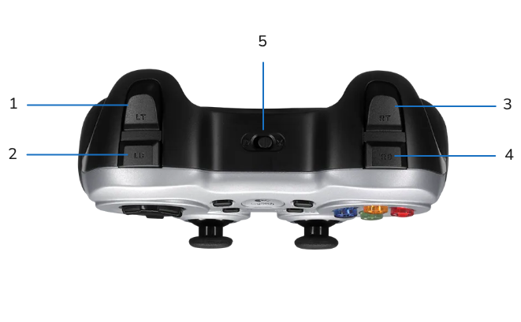

| 序号 | 按键名称 | 说明 |
| --- | --- | --- |
| 1 | LT | 左侧扳机键 |
| 2 | LB | 左侧肩键 |
| 3 | RT | 右侧扳机键 |
| 4 | RB | 右侧肩键 |
| 5 | 档位按键（D 模式/X 模式） | 需确保档位按键处于D模式 |

#### 4.2.3 机器人准备与运行流程

使用遥控器控制机器人进入运行状态时，建议按以下流程操作：

1. 机器人默认处于悬吊状态。系统开机后首先进行关节状态自检，系统会提示“自检成功”或“自检失败”。
2. 如果提示“自检失败”，根据《4.1.1 开机》章节查看关节状态信息，如果是关节超限，将各个关节摆到关节零位附近，重启机器人；如果是关节断开，则联系售后或相关技术人员；
3. 等待提示“自检成功”后，按下组合按键 `LB + RB + A`，机器人进入准备状态。完成后系统会提示“准备就绪”。
4. 等待准备完成后，将机器人放下并确认站稳，再按下组合按键 `LB + RB + B`，机器人进入行走模型（强化学习）。
5. 机器人进入行走模型后，可通过遥控组合按键进行模型动作或者舞蹈切换。动作或者舞蹈执行完成后，机器人自动返回行走模型。
6. 如需退出当前运行状态，应先将机器人置于吊机挂钩勾上的保护状态（非悬吊状态），再按下组合按键 `LB + RB + Y`，使机器人进入阻尼模式。进入阻尼后，机器人会卸力下落。
7. 如需重新操作，应先将机器人重新置于悬吊状态，再按下组合按键 `LB + RB + X`，系统进入待机模式，之后可重新从准备步骤开始操作。

警告（Warning）：

- `LB + RB + Y` 进入阻尼模式前，必须确认机器人具备吊装保护或人工稳定控制条件，否则机器人可能直接失去支撑并摔倒。
- `LB + RB + B` 进入行走模型前，必须确认机器人已完成准备状态、已放下站稳且场地具备运行条件。
- 自检失败时，不得继续执行准备、进入模型或动作切换操作。

#### 4.2.4 状态切换类组合按键

| 组合按键 | 功能 | 使用条件 |
| --- | --- | --- |
| `LB + RB + A` | 进入准备状态 | 自检成功，机器人处于悬吊保护状态 |
| `LB + RB + B` | 进入行走模型（强化学习） | 准备完成，机器人已放下并站稳 |
| `LB + RB + Y` | 进入阻尼模式 | 机器人处于吊机挂钩保护或人工稳定控制条件下 |
| `LB + RB + X` | 进入待机模式 | 机器人重新置于悬吊状态后执行 |

#### 4.2.5 单动作交互类组合按键

| 组合按键 | 功能 | 使用条件 |
| --- | --- | --- |
| `LB + 方向键左` | 触发打招呼动作（连续） | 再次按下相同组合按键，可停止打招呼动作 |
| `LB + 方向键上` | 触发鼓掌动作（连续） | 再次按下相同组合按键，可停止鼓掌动作 |
| `LB + 方向键右` | 触发蹲起动作 | 机器人需处于蹲下状态，蹲起后再次按键进入行走模式 |
| `LB + 方向键下` | 触发蹲下动作 | 机器人需处于站立状态，可下蹲至地面，随后进入阻尼模式 |
| `RB + 方向键左` | 触发比心动作 | 机器人需处于行走模式下的站立状态 |
| `RB + 方向键上` | 触发敬礼动作 | 机器人需处于行走模式下的站立状态 |
| `RB + 方向键右` | 触发握手动作 | 机器人需处于行走模式下的站立状态 |
| `RB + 方向键下` | 触发击掌动作 | 机器人需处于行走模式下的站立状态 |

#### 4.2.6 舞蹈/组合表演类组合按键

| 组合按键 | 功能 | 使用条件 |
| --- | --- | --- |
| `LB + RB + 方向键左` | 触发动太极舞蹈 | 机器人需处于行走模式下的站立状态 |
| `LB + RB + 方向键上` | 触发静太极舞蹈 | 机器人需处于行走模式下的站立状态 |
| `LB + RB + 方向键右` | 触发滑步舞蹈 | 机器人需处于行走模式下的站立状态 |
| `LB + RB + 方向键下` | 触发相亲相爱舞蹈 | 机器人需处于行走模式下的站立状态 |

#### 4.2.7 配置菜单类组合按键

| 组合按键               | 功能                     | 说明                                                         |
| ---------------------- | ------------------------ | ------------------------------------------------------------ |
| `LT 按住 + RT 连按3次` | 一级菜单切换             | 包括：起身配置、速度配置、导航配置、语言配置，各选项循环切换 |
| `RT 按住 + LT 连按3次` | 二级菜单（起身配置）切换 | 包括：站立准备、蹲起准备、坐起准备、躺起准备，各选项循环切换；当前仅集成站立准备，其余后续完善 |
|                        | 二级菜单（速度配置）切换 | 包括：标准速度、高速速度，各选项循环切换                     |
|                        | 二级菜单（导航配置）切换 | 包括：遥控模式、导航模式，各选项循环切换                     |
|                        | 二级菜单（语言配置）切换 | 包括：中文、英文，各选项循环切换                             |

### 4.3 基础控制指令

本节仅说明机器人在行走模式下的基础运动控制方式。ROS 指令控制、网页控制和高级动作编排不在本节展开。

#### 4.3.1 行走与转向控制

当机器人已进入行走模式后，可通过遥控器左右摇杆进行直接控制，具体映射如下：

- 左摇杆前推：控制机器人前进
- 左摇杆后拉：控制机器人后退
- 左摇杆左推：控制机器人向左横向移动
- 左摇杆右推：控制机器人向右横向移动
- 右摇杆左推：控制机器人向左自旋
- 右摇杆右推：控制机器人向右自旋
- 右摇杆前后方向：当前版本不处理

#### 4.3.2 停止控制

当需要停止机器人运动时，应将左右摇杆回中，使机器人退出当前运动输入并恢复稳定站立状态。

注意（Caution）：

- 停止控制适用于正常运动过程中的减速和停稳，不替代无线急停或阻尼处置。
- 若机器人出现异常失稳、误动作或周边突发危险，应优先按照第二章要求执行紧急处置。

#### 4.3.3 蹲下与起立说明

蹲下和蹲起不作为基础摇杆运动控制处理，而通过遥控器组合按键触发，具体如下：

- `LB + 方向键下`：触发下蹲动作。机器人需处于站立状态，可下蹲坐在躺椅，随后进入阻尼模式。
- `LB + 方向键右`：触发蹲起动作。机器人需处于下蹲状态，完成蹲起后自动进入行走模式。

执行蹲下或蹲起动作前，应确认机器人周边空间充足、支撑条件可靠，且无人员处于潜在碰撞范围内。

## 第五章 运动控制与导航

本章主要说明机器人在行走模式下的运动控制方式、控制模式切换及与导航相关的基础接口约束。涉及更复杂的自主导航算法、路径规划策略和高级感知能力时，应结合实际软件版本与项目配置进一步确认。

### 5.1 步态模式选择

当前版本已明确支持基于行走模型的双足运动控制。机器人在完成准备状态并站稳后，可进入行走模型（强化学习）执行前进、横移和自旋等基础运动。

提示（Notice）：

- 本说明书当前版本未对快走、上下楼梯、斜坡行走等扩展步态进行详细展开。
- 若后续版本支持更多步态模式，建议在正式发布时补充对应的使用条件、速度范围和风险说明。

### 5.2 路径规划与自主导航设置

机器人支持两种基础控制模式：

- 遥控模式
- 导航模式

默认控制模式为遥控模式。参考《4.2.7 配置菜单类组合按键》章节，一级菜单切换到导航配置选项后，通过按住 `RT` 并连续按 3 次 `LT` 进行二级菜单选项切换，可在遥控模式和导航模式之间循环切换。

模式切换规则如下：

- 遥控模式：只接收自定义消息控制。
- 导航模式：只接收 `cmd_vel` 消息控制。

在导航模式下，可通过 ROS 话题 ` /cmd_vel ` 发送 `geometry_msgs/Twist` 消息进行运动控制。示例如下：

```bash
ros2 topic pub /cmd_vel geometry_msgs/Twist "linear:
  x: 0.0
  y: 0.0
  z: 0.0
angular:
  x: 0.0
  y: 0.0
  z: 0.3" --once
```

注意（Caution）：

- 在切换控制模式前，应明确当前控制链路和接管责任，避免因模式不一致导致指令无效或误判。
- 路径规划算法、地图构建方式和自主导航任务编排不在当前说明书版本展开，后续可根据软件版本补充。

## 第六章 日常维护与保养

本章主要说明普通用户可执行的日常维护与保养要求。涉及关节拆装、内部线缆维护、控制器维修、重新标零或其他专业性操作时，应由具备条件的技术人员处理。

### 6.1 清洁与外观保养规范

机器人在日常使用后，应根据环境情况对外观和关键感知部件进行基础清洁，以保持设备整洁并降低感知异常风险。

可进行常规清洁的部位包括：

- 机身外壳表面
- 传感器外表面
- 电池外表面
- 背部把手和外露非精密结构表面

清洁时建议使用干燥、柔软、无明显掉絮的清洁布。必要时可使用少量中性清洁剂配合擦拭，但不得使液体流入设备内部。

注意（Caution）：

- 不得对关节缝隙、接口内部、带电部位或机身内部直接喷水、泼液或使用大量湿布擦洗。
- 不得使用强腐蚀性溶剂、酒精浸泡、尖锐工具或硬质刷具清洁设备表面。
- 清洁前应确保机器人处于安全静止状态，必要时先断电并拆下电池。

### 6.2 关节与传动部件维护

普通用户在日常使用中，不应自行拆解关节或传动部件。日常维护重点应放在外观观察和异常识别上。

建议定期检查以下内容：

- 关节外部是否存在磕碰、松动、裂纹或异常变形
- 关节运动时是否出现异常卡滞、异响或明显发热
- 运动后各关节状态显示是否正常，是否存在超限或断连提示

若发现异常，应停止继续使用，并由具备条件的人员进一步检查。

### 6.3 电池维护与更换周期

电池属于关键供电部件，日常使用中应做好充放电和存放管理。

建议遵守以下要求：

- 按照第三章要求拆下电池后单独充电。
- 避免电池受到跌落、冲击、挤压、穿刺或高温暴晒。
- 长时间不使用时，应定期检查电池状态，并按规范进行维护充电。
- 若发现电池鼓包、异味、异常发热、壳体破损或指示异常，应立即停止使用。

电池更换周期与实际使用频率、充放电习惯、环境温度和电池健康度相关，当前版本说明书不统一给出固定更换周期，建议结合实际检测结果和售后建议处理。

### 6.4 传感器清洁与校准检查

机器人配备深度相机、激光雷达和 IMU 等传感器。用户可进行基础外观清洁和运行状态检查，但不建议普通用户自行执行复杂内部校准操作。

建议重点检查以下内容：

- 深度相机视窗是否存在灰尘、指纹、污渍或遮挡
- 激光雷达外表面是否清洁，是否存在遮挡或碰撞痕迹
- 控制面板中的 IMU 状态数据是否异常
- 开机自检和运行过程中是否出现与传感器相关的异常表现

如需进行零位修正、专项校准或传感器深度配置，应由具备条件的人员按照专门技术流程执行。

### 6.5 软件更新与日志管理

普通用户不进行固件升级操作。日常维护中，更重要的是关注日志信息和运行异常记录。

建议操作人员在以下情况下保存或记录系统日志：

- 开机自检失败
- 关节断连或关节超限
- 动作异常、姿态异常或控制异常
- 网络通信异常或模式切换异常

控制面板中的系统日志区域可用于辅助查看模块启动、自检结果、状态切换和异常提示等信息。

### 6.6 定期维护计划表

建议按照以下周期执行基础维护：

| 周期 | 维护项目 | 建议内容 |
| --- | --- | --- |
| 每次使用前 | 外观与安全检查 | 检查电池、急停器、机体外观、场地和传感器表面 |
| 每次使用后 | 基础清洁 | 擦拭机身外壳、传感器外表面和电池外表面 |
| 每周或按高频使用情况 | 运行状态复查 | 检查关节状态、日志记录、网络连接和遥控器状态 |
| 每月或按项目周期 | 综合维护检查 | 由具备条件的人员评估关节状态、电池健康度、零位偏差和关键部件磨损情况 |

提示（Notice）：

- 若机器人在高频演示、复杂实验或室外受限环境中使用，应适当缩短维护检查周期。
- 建议结合附录中的维护保养记录表，持续记录维护时间、异常现象和处理结果。

## 第七章 故障诊断与排除

本章主要针对普通用户在使用过程中可能遇到的常见故障现象，提供基础排查思路和处理建议。涉及内部硬件维修、专业校准、关节拆装或软件深度调试时，应由具备条件的技术人员处理。

### 7.1 常见故障现象与处理建议

| 故障现象 | 可能原因 | 处理建议 |
| --- | --- | --- |
| 开机自检失败 | 关节通信断开；关节当前位置与零位角度差过大；机体姿态异常 | 停止后续操作，检查机器人姿态、关节状态和系统日志；必要时断电并联系技术人员 |
| 关节断连 | 关节通信异常；相关模块未正常启动；线缆或连接异常 | 通过控制面板查看关节状态和系统日志；不得继续执行动态动作 |
| 关节超限 | 当前姿态异常；关节位置偏差过大；执行动作不合规 | 停止运动，排查当前姿态和控制输入，必要时重新初始化 |
| 机器人无法进入准备状态 | 自检未成功；机器人未处于悬吊保护状态；组合按键操作不符合条件 | 确认自检成功、悬吊状态正确，并重新执行 `LB + RB + A` |
| 机器人无法进入行走模型 | 准备状态未完成；机器人未放下站稳；当前模式或状态不满足要求 | 确认系统提示“准备完成”，并检查机器人站立状态后重新执行 `LB + RB + B` |
| 网络无法连接 | 网线连接异常；网口使用错误；本机网络配置不正确 | 优先使用靠近机器人中间的默认有线网口，确认 IP 配置及物理连接状态 |
| 控制面板打不开 | IP 地址错误；浏览器地址或端口错误；网络未连通 | 确认访问地址为机器人 IP + `8088`，并先测试网络连通性 |
| 机器人运动不稳或姿态异常 | 场地不平整；控制输入不合适；姿态或关节状态异常 | 立即停止运动，检查地面条件、控制输入、自检结果和 IMU/关节状态 |
| 电池无法正常充电或电量异常 | 电池连接异常；充电器状态异常；电池健康度下降 | 检查连接顺序、指示灯状态和电池外观，异常时停止充电 |

### 7.2 自检报错处理流程

当机器人开机后提示自检失败时，建议按以下流程处理：

1. 立即停止后续准备、进入模型或动作控制操作。
2. 确认机器人当前姿态是否安全，必要时先断电。
3. 通过控制面板查看关节状态颜色提示和系统日志信息。
4. 重点检查是否存在关节断连、关节超限或机体姿态异常。
5. 在未查明原因前，不得强行继续运行。
6. 如问题无法排除，应由具备条件的人员进一步处理。

提示（Notice）：

- 自检失败时继续运行，可能导致姿态异常、误动作或跌倒风险。
- 对于长期使用后出现的零位偏差问题，可在具备条件时配合专用工具进行重新标零。

### 7.3 平衡异常/行走不稳排查

当机器人出现站立不稳、行走发飘、横摆明显或姿态异常时，可优先排查以下内容：

- 场地是否平整、干燥，是否存在湿滑、起伏或障碍物
- 机器人是否已按规范完成准备状态和进入模型流程
- 当前摇杆输入、ROS 速度指令或控制模式是否正确
- IMU 状态数据是否异常
- 关节状态是否存在黄色或红色提示

处理建议如下：

1. 立即降低控制输入或停止当前运动。
2. 将机器人恢复至安全可控状态。
3. 检查场地条件、自检状态、关节状态和 IMU 状态。
4. 必要时重新初始化后再进行测试。

### 7.4 通信中断与重连方法

若出现网络无法连接、远程登录失败或控制面板无法访问等通信异常，建议按以下顺序排查：

1. 检查计算机与机器人是否正确连接到默认有线网口。
2. 确认机器人默认 IP 地址是否为 `192.168.12.100`，并检查本机网段配置是否正确。
3. 检查网线、接口接触情况及网络指示状态。
4. 重新尝试使用 `NoMachine` 远程登录。
5. 重新尝试通过浏览器访问机器人 IP + `8088`。

若无线连接异常，建议优先切换回有线方式进行排查和恢复。

### 7.5 硬件故障识别与报修流程

当出现以下情况时，建议视为疑似硬件故障，并暂停继续使用：

- 关节持续断连或重复报错
- 电池鼓包、异常发热、壳体破损或无法正常供电
- 传感器外观受损、明显松动或感知异常持续出现
- 机身结构件破损、变形或关键连接部位松动
- 风扇、接口区或其他关键部位出现异常异响、异味或冒烟现象

报修时建议同时提供以下信息：

- 设备型号与编号
- 故障发生时间和使用场景
- 控制面板截图或系统日志信息
- 故障前后的操作步骤说明

### 7.6 待机与恢复

如需重新开始准备流程，可在机器人重新置于悬吊状态后，通过遥控器组合按键 `LB + RB + X` 使机器人进入待机模式。

注意（Caution）：

- 待机模式不等同于恢复出厂设置。
- 当前版本说明书不提供普通用户级别的恢复出厂设置操作。
- 在异常原因未查明前，不应反复通过待机模式替代故障排查。

## 第八章 存储与运输

本章主要说明机器人在长期存放、短距离搬运和常规运输过程中的基本要求，以降低结构损伤、电池风险和运输过程中的二次故障。

### 8.1 长期存储条件与电池保养

当机器人需要长期停用或存放时，应先完成清洁检查，并将电池从机器人本体上拆下后单独存放。

建议执行以下要求：

- 机器人本体与电池分开存放。
- 存放前检查机身外观、电池外观和接口区域是否存在异常。
- 电池应避免长期处于完全亏电、异常高温或受潮环境。
- 长时间存放期间，应定期检查电池状态并按规范进行维护充电。

提示（Notice）：

- 长期存放前，建议同步记录设备当前状态、存放时间和电池状态，便于后续重新启用。
- 若电池在存放期间出现鼓包、异味、异常发热或壳体损伤，应停止继续使用。

### 8.2 短距离搬运与移动规范

机器人短距离搬运时，应由至少两人配合扶持或搬运，必要时结合吊装保护。不得单人强行搬运，不得通过拖拽下肢、抓提关节部位或其他不规范方式移动设备。

搬运时建议遵守以下原则：

- 确保机器人处于断电或安全静止状态。
- 优先利用可靠支撑点和背部把手进行受控辅助搬扶。
- 搬运路径应提前清理，避免门槛、线缆、台阶边缘和湿滑区域。

### 8.3 运输包装与固定要求

机器人运输时，应优先使用原包装箱体或等效固定工装，并将机器人固定在受控支撑状态下运输，不得以站立自由状态运输。

建议遵守以下要求：

- 使用与设备尺寸和重量匹配的包装箱体或保护工装。
- 运输前确认机器人已可靠固定，避免晃动、滑移、碰撞和跌落。
- 电池应根据运输要求单独处理和固定，不应松散放置在包装内。
- 遥控器、无线急停器、充电器及其他附件应分类包装，避免与机器人本体硬性碰撞。

### 8.4 温湿度与防护要求

机器人及配套电池在存储和运输过程中，应避免高温、低温、受潮、凝露、积水和强腐蚀性环境。

建议遵守以下原则：

- 存储环境应保持干燥、通风、无明显粉尘和无腐蚀性气体。
- 运输过程中应采取必要的防潮、防震和防压措施。
- 设备从低温环境转入温暖环境后，如存在凝露风险，应待设备恢复稳定后再上电使用。

注意（Caution）：

- 不得在强雨、积水或明显受潮状态下搬运、装箱或重新上电。
- 存储和运输环境不当，可能导致电池性能下降、传感器异常、接口腐蚀或结构损伤。
